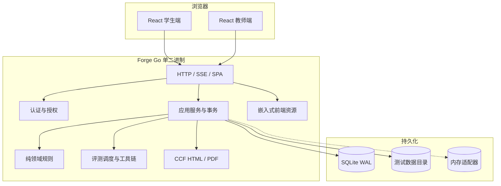

# Forge 系统架构

HTTP API 统一位于 `/api/v1`，预发布阶段不承诺兼容。OpenAPI 契约见
`api/openapi.yaml`。

## 1. 部署拓扑

标准部署是一个反向代理加一个 Forge 进程。SQLite、测试数据和日志应放在持久卷上；
自动评测若启用，评测进程必须视为高风险执行面。

## 2. 分层职责

| 目录 | 职责 | 依赖规则 |
|---|---|---|
| `cmd/forge/` | 配置加载、依赖装配、HTTP 服务、worker 生命周期、优雅关闭 | 只做组装 |
| `internal/domain/` | 类型、题面校验、开赛预检、榜单、比较、子任务 DAG | 无 I/O |
| `internal/ports/` | Store、广播、时钟、ID 等端口 | 只依赖领域 |
| `internal/app/` | 比赛、题目、提交、判题、统计、比赛包等用例 | 通过端口持久化 |
| `internal/auth/` | 密码哈希、会话 token、限流、短时流票据 | 通过端口存取 |
| `internal/judge/` | 编译、执行、资源限制、checker/interactor、worker pool | 不进入 HTTP 层 |
| `internal/testdata/` | 测试文件仓、配对与答案 key 扫描 | 无业务状态 |
| `internal/transport/http/` | 路由、鉴权、脱敏、SSE、SPA 回退、统一错误体 | 调用应用服务 |
| `internal/pdf/` | CCF 模板与浏览器 PDF | 消费领域对象 |
| `internal/realtime/` | 按比赛过滤的 SSE Hub | 无持久化 |
| `internal/web/` | `//go:embed internal/web/dist` | 构建产物 |
| `frontend/` | React/TypeScript SPA 源码 | 浏览器与构建期 |

## 3. 前端结构

- `src/app/`：顶层路由、会话门禁、全局壳层。
- `src/pages/`：登录等页面级入口。
- `src/views/`：学生工作台、教师控制台。
- `src/components/`：可复用 UI、Monaco、Markdown、榜单、考场安全面板。
- `src/features/`：与领域相关但不依赖页面的交互逻辑。
- `src/api/`：唯一 HTTP 客户端与类型契约。
- `src/store/`：本地会话、草稿、桌面模式和解锁状态；草稿按用户隔离。
- `src/realtime/`：SSE 票据交换、断线重建与事件分发。

生产构建输出到 `internal/web/dist`，随后由 Go `embed.FS` 托管。不得手改构建产物。

## 4. 请求与数据流

### 4.1 登录与访问

1. 浏览器调用 `/api/v1/auth/login`，服务端写入 `forge_session` HttpOnly Cookie；
   受控 API 客户端仍可读取响应中的 Bearer token。
2. 服务端持久化会话 token 的 SHA-256 摘要，并在每次请求校验当前用户、角色和比赛访问权。
3. 学生读取题面时，服务端剥离测试点、标准答案、checker/interactor 源码。
4. SPA 启动时通过 `/api/v1/auth/me` 恢复身份；浏览器从不把长期凭证写入 localStorage。
5. SSE 先换取独立的短时 `forge_stream` HttpOnly cookie 票据，再建立事件流。

### 4.2 提交与判题

1. 学生提交到 `/api/v1/contests/{cid}/submissions`。
2. 应用层校验比赛状态、严格时间窗、IP 机位、参赛资格、题目归类和 64 KiB 上限。
3. 选择题即时判分；其他题型创建 `queued` 提交并广播 `submission.created`。
4. 自动评测启用时，worker 编译一次并按测试点执行。
5. 结果通过 `submission.judged` 与 `ranking.updated` 推送，并持久化逐点详情。
6. 自动评测关闭时，教师在教师控制台回写总分或逐点结果。

### 4.3 开赛预检

`StartContest` 在存储事务中读取比赛、题目、编组和用户，调用
`domain.ValidateContestStart`。任何悬空绑定、题面错误、分值异常或题型源码缺失都会
回滚状态转换，因此不存在“半开赛”状态。

## 5. 数据与恢复

- 生产默认 `FORGE_STORE=sqlite`，数据库位于 `FORGE_DATA_DIR/forge.db`。
- SQLite 使用 WAL；备份必须包含主库、`-wal` 和 `-shm`，或在停写后做一致性备份。
- 测试数据独立于数据库存放；恢复时必须与数据库快照匹配。
- `memory` 仅用于测试和一次性演示，不提供重启恢复。

## 6. 安全边界

- 所有管理写操作要求教师或管理员角色。
- 学生身份取自会话，不信任请求体中的 `userId`。
- 请求体、测试文件上传和源文件各有独立上限。
- CSP、`X-Frame-Options: DENY`、nosniff、CORP/COOP 和 no-store API 缓存策略默认开启。
- `FORGE_TRUST_PROXY` 仅可在可信反向代理之后开启，否则机位 IP 可被伪造。
- 当前本地评测器没有文件系统、网络或 OS 用户隔离。自动评测默认关闭，并要求
  `FORGE_ALLOW_UNSAFE_LOCAL_JUDGE=1` 明确确认风险。

## 7. 可观测性与运维

- `/healthz`：进程存活。
- `/readyz`：持久化可用。
- 每个响应带 `X-Trace-Id`，服务日志记录方法、路径、耗时与 Trace ID。
- SSE 客户端展示在线、重连和离线状态。
- 发布前按 `docs/deployment.md` 执行备份、冒烟和回滚检查。
